**Universidad del Valle de Guatemala** Facultad de Ingeniería — Departamento de Ciencias de la Computación

**Eliazar Canastuj 23384**

**Pablo Cabrera 231156**

**Jose Sanchez 231221**

**Ángel Mérida 23661**

**Samuel Mejía 23442**

**Curso:** CC3067 Redes

**Fecha:** 17 de noviembre de 2026

# 1. Antecedentes y giro del negocio

**AgroSense GT** es una startup guatemalteca del sector AgTech dedicada al desarrollo y operación de soluciones de internet de las cosas y analítica en la nube para agricultura de precisión y gestión inteligente de riego en fincas del país. Su plataforma centraliza lecturas agroclimáticas en tiempo real (humedad de suelo, pH, precipitación y evapotranspiración) para optimizar el consumo hídrico y el rendimiento de los cultivos.

La empresa requiere segmentar lógicamente su red de acuerdo con las siguientes necesidades operativas:

- **Equipo de Ventas (25 personas):** ejecutivos comerciales B2B y asesores técnicos que gestionan contratos con cooperativas e ingenios a través del CRM y paneles corporativos.
- **Equipo de TI (15 personas):** ingenieros de firmware IoT, desarrolladores backend/frontend, científicos de datos y especialistas DevOps encargados de administrar la infraestructura y dar soporte.
- **Data Center (5 servidores):** infraestructura crítica compuesta por cinco instancias dedicadas a ingestión y procesamiento de datos:
    1. srv-mqtt-01 (10.0.0.100): broker de ingestión de telemetría IoT (MQTT/HTTPS).
    2. srv-worker-02 (10.0.0.101): motor de procesamiento de colas y alertas de riego en tiempo real.
    3. srv-tsdb-03 (10.0.0.102): base de datos de series temporales para métricas de sensores.
    4. srv-pg-04 (10.0.0.103): base de datos relacional transaccional, PostgreSQL para clientes y facturación.
    5. srv-api-05 (10.0.0.104): API gateway y backend para aplicaciones móviles y web.
- **Red de Visitas:** conectividad temporal aislada para consultores agrónomos, proveedores de sensores y clientes en reuniones presenciales.

En la Fase 2 la empresa agrega servicios internos (DNS e intranet de Recursos Humanos), controles de seguridad entre segmentos y un sitio web público para Ventas, publicado desde una zona desmilitarizada (DMZ).

# 2. Selección y justificación de la plataforma en la nube

Se seleccionó Microsoft Azure bajo la suscripción académica Azure for Students para virtualizar el ecosistema de red de AgroSense GT.

- **Alineación técnica y control de segmentación:** Azure permite implementar redes virtuales (Virtual Networks o VNets) divididas en subredes mediante direccionamiento CIDR personalizado y aplicar filtrado de tráfico granular mediante grupos de seguridad de red (Network Security Groups o NSGs).
- **Control de acceso y conectividad:** soporta la coexistencia de subredes privadas y mecanismos de administración remota segura sin exponer los servidores de bases de datos directamente a internet.
- **Viabilidad económica y protección contra sobrecostos:** la modalidad Azure for Students otorga \$100 USD en créditos verificando el correo institucional sin exigir tarjeta de crédito. Esto garantiza un límite de gasto estricto que impide cobros imprevistos si algún recurso permanece activo por error durante las pruebas.

En la Fase 2 la infraestructura se volvió a desplegar en la región **Brazil South**, porque era la región permitida por la suscripción que tenía capacidad para los tamaños de VM necesarios.

# 3. Diseño y segmentación, cálculos de subneteo VLSM

El diseño parte del bloque privado base 10.0.0.0/24 (256 direcciones IPv4 totales) aplicando máscara de subred de longitud variable para dimensionar cada segmento según su demanda real.

**Restricción de reserva de direcciones en Microsoft Azure.** En cada subred creada dentro de una VNet, Azure reserva de forma obligatoria 5 direcciones IP para control interno (IPs útiles = 2^h − 5):

- Primera IP (.0 del bloque): dirección de red.
- Segunda IP (.1 del bloque): default gateway de la subred asignado por Azure.
- Tercera y cuarta IP (.2 y .3 del bloque): direcciones mapeadas por Azure para los servicios de DNS de la plataforma.
- Última IP del bloque: dirección de broadcast de la subred.

**Tabla de segmentación VLSM**

| Subred / Identificador | Requerimiento | Prefijo y máscara | IP de red | IPs reservadas por Azure (4 iniciales) | Rango de IPs útiles | Broadcast | Capacidad útil (total) |
|------------------|----------|--------------|---------|-------------|--------------|---------|-------------|
| **Ventas** (snet-ventas) | 25 personas | /27 (255.255.255.224) | 10.0.0.0 | 10.0.0.0 – 10.0.0.3 | 10.0.0.4 – 10.0.0.30 | 10.0.0.31 | 27 útiles (32) |
| **Visitas** (snet-visitas) | ~20 disp. | /27 (255.255.255.224) | 10.0.0.32 | 10.0.0.32 – 10.0.0.35 | 10.0.0.36 – 10.0.0.62 | 10.0.0.63 | 27 útiles (32) |
| **TI** (snet-ti) | 15 personas | /27 (255.255.255.224) | 10.0.0.64 | 10.0.0.64 – 10.0.0.67 | 10.0.0.68 – 10.0.0.94 | 10.0.0.95 | 27 útiles (32) |
| **Data Center** (snet-datacenter) | 5 servidores | /28 (255.255.255.240) | 10.0.0.96 | 10.0.0.96 – 10.0.0.99 | 10.0.0.100 – 10.0.0.110 | 10.0.0.111 | 11 útiles (16) |
| **Reserva Futura A** → **DMZ** (snet-dmz) en la Fase 2 | Escalabilidad | /28 (255.255.255.240) | 10.0.0.112 | 10.0.0.112 – 10.0.0.115 | 10.0.0.116 – 10.0.0.126 | 10.0.0.127 | 11 útiles (16) |
| **Reserva Futura B** | Escalabilidad | /25 (255.255.255.128) | 10.0.0.128 | 10.0.0.128 – 10.0.0.131 | 10.0.0.132 – 10.0.0.254 | 10.0.0.255 | 123 útiles (128) |

**Justificación matemática del dimensionamiento**

1. **Subred de Ventas (10.0.0.0/27):** para cubrir 25 personas más las 5 direcciones reservadas por Azure se requieren al menos 30 direcciones (25 + 5 = 30). El bloque inmediato superior es 2^5 = 32 direcciones (/27), entregando 27 IPs útiles (10.0.0.4 a 10.0.0.30).
2. **Subred de Visitas (10.0.0.32/27):** se estima una concurrencia de ~20 dispositivos para visitantes externos con tope máximo de 27 hosts simultáneos dentro de un bloque /27 (10.0.0.36 a 10.0.0.62), manteniendo bloques contiguos sin fragmentar el direccionamiento.
3. **Subred de TI (10.0.0.64/27):** aunque 15 personas parecen caber en un bloque de 16 direcciones (/28), al restar las 5 IPs reservadas por Azure en un /28 solo quedan 16 − 5 = 11 IPs útiles, lo cual resulta insuficiente para 15 hosts. Por ello es indispensable asignar un prefijo /27 (27 IPs útiles), dejando 12 direcciones disponibles para crecimiento técnico.
4. **Subred de Data Center (10.0.0.96/28):** para alojar 5 servidores más las 5 direcciones reservadas se requieren 10 direcciones (5 + 5 = 10). Un bloque /28 (2^4 = 16 direcciones) proporciona 11 IPs útiles (10.0.0.100 a 10.0.0.110), cubriendo los 5 servidores actuales y permitiendo duplicar la capacidad de cómputo sin rediseñar la subred. En la Fase 2 se usan dos de esas IPs libres: 10.0.0.105 (servidor DNS) y 10.0.0.106 (intranet de RRHH).
5. **DMZ (10.0.0.112/28, Fase 2):** la Reserva Futura A se destinó a la zona desmilitarizada. Sus 11 IPs útiles alcanzan para el servidor web público (10.0.0.116) y futuros servicios expuestos a Internet, sin tocar el direccionamiento de las demás subredes.

# 4. Arquitectura de seguridad y control de tráfico (Fase 1)

En Microsoft Azure, todas las subredes que pertenecen a una misma VNet (10.0.0.0/24) se comunican entre sí de manera predeterminada a través de las rutas del sistema del enrutador virtual de Azure. Para evitar que dispositivos en la subred de visitas alcancen los servidores del data center o los equipos corporativos, y para habilitar de forma controlada la prueba de concepto, se asoció un network security group específico a cada subred. La tabla siguiente es la política de la Fase 1; la política final, ampliada con la DMZ, el DNS y la intranet, está en la sección 10.

| NSG asociado | Prio. | Regla | Origen | Destino | Protocolo / Puerto | Acción y propósito técnico |
|------------|--------|--------------|------------|------------|-----------|-------------------------------|
| **nsg-ventas** | 100 | Allow-ICMP-From-TI | 10.0.0.64/27 | 10.0.0.0/27 | ICMP (todos) | Permitir: habilita pruebas de diagnóstico y conectividad (ping) desde la subred de TI. |
| **nsg-ti** | 100 | Allow-ICMP-Internal | 10.0.0.0/24 | 10.0.0.64/27 | ICMP (todos) | Permitir: permite recibir respuestas de ping y telemetría de red desde cualquier subred interna. |
| **nsg-visitas** | 100 | Deny-Internal-VNet | 10.0.0.32/27 | 10.0.0.0/24 | Cualquiera (\*) | Denegar: bloquea cualquier intento de conexión desde Visitas hacia Ventas, TI o Data Center, permitiendo solo salida hacia internet (80/443). |
| **nsg-datacenter** | 100 | Allow-Admin-From-TI | 10.0.0.64/27 | 10.0.0.96/28 | TCP 22, ICMP | Permitir: solo el segmento de TI puede administrar los servidores vía SSH y realizar diagnósticos ICMP. |
| **nsg-datacenter** | 110 | Allow-API-From-Ventas | 10.0.0.0/27 | 10.0.0.104/32 | TCP 443 | Permitir: el equipo de Ventas solo puede comunicarse con el API gateway (10.0.0.104), bloqueando el acceso directo a las bases de datos. |

# 5. Diagrama y segmentación de red (Fase 1)

La Figura 1 presenta la topología lógica de la red de AgroSense GT diseñada en la Fase 1. El diagrama parte de la red virtual vnet-agrosense-gt (10.0.0.0/24), que agrupa las cuatro subredes operativas segmentadas mediante VLSM: snet-ventas (10.0.0.0/27), snet-visitas (10.0.0.32/27), snet-ti (10.0.0.64/27) y snet-datacenter (10.0.0.96/28), además de los dos bloques reservados para escalabilidad futura (10.0.0.112/28 y 10.0.0.128/25). Todas las subredes residen dentro de la misma VNet y se enrutan de forma predeterminada a través del router virtual de Azure.

Sobre esa base, el diagrama representa la arquitectura de seguridad implementada con un NSG por subred. Las líneas azules indican el tráfico este-oeste explícitamente permitido: la subred de TI administra el Data Center por SSH (TCP 22) e ICMP, y el equipo de Ventas alcanza únicamente el API gateway srv-api-05 (10.0.0.104) por HTTPS (TCP 443), sin acceso directo a las bases de datos. La línea roja discontinua refleja la regla Deny-Internal-VNet del nsg-visitas, que aísla por completo a la red de Visitas del resto de la VNet y solo le permite salida hacia internet. La versión actualizada del diagrama, con la DMZ, el DNS y los servidores web, está en la sección 8.

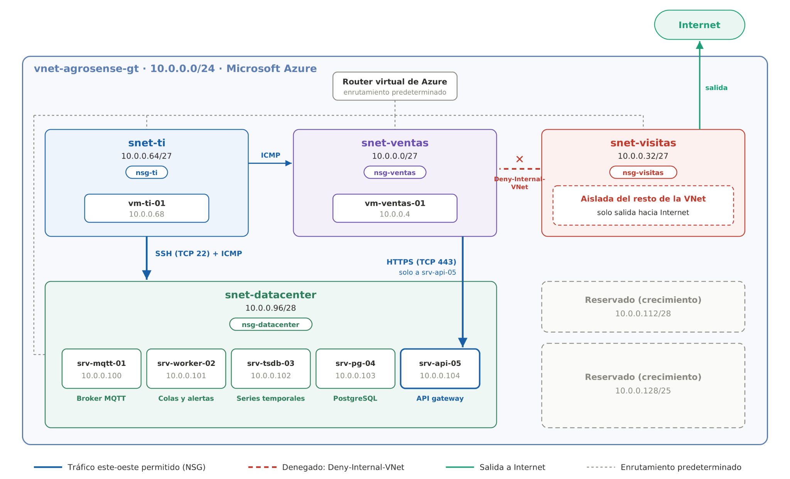{width=100%}

# 6. Implementación y pruebas de concepto (Fase 1)

**Creación de la red virtual y subredes.** Para validar el diseño de red propuesto se implementó una prueba de concepto en Microsoft Azure bajo la suscripción académica. La infraestructura se organizó dentro del grupo de recursos rg-agrosense-prod, utilizando una red virtual denominada vnet-agrosense-gt con el espacio de direccionamiento privado 10.0.0.0/24, segmentada en snet-ventas (10.0.0.0/27), snet-visitas (10.0.0.32/27), snet-ti (10.0.0.64/27) y snet-datacenter (10.0.0.96/28). Los bloques 10.0.0.112/28 y 10.0.0.128/25 no se crearon en esa fase y quedaron reservados para crecimiento futuro. La Figura 2 muestra las subredes creadas.

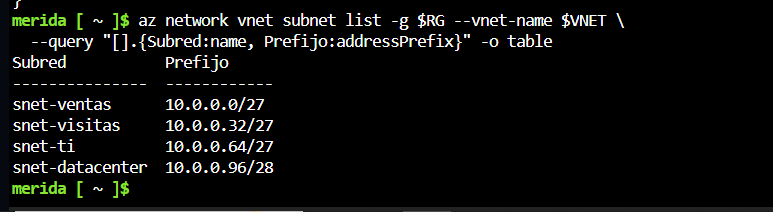{width=75%}

**Configuración de seguridad y despliegue de instancias.** Se crearon cuatro NSG, uno por subred, con las reglas de la sección 4:

- nsg-ventas: permite tráfico ICMP entrante desde la subred de TI (10.0.0.64/27), necesario para la prueba de conectividad.
- nsg-ti: permite pings iniciados desde cualquier subred interna.
- nsg-visitas: reglas de salida que bloquean todo tráfico hacia la VNet y hacia Internet, excepto HTTP/HTTPS (80 y 443).
- nsg-datacenter: permite SSH e ICMP desde TI y HTTPS desde Ventas únicamente hacia el API gateway (10.0.0.104). La regla Deny-VNet-Inbound (prioridad 4000) bloquea cualquier otro acceso interno, ya que Azure permite por defecto todo el tráfico entre subredes de una misma VNet.

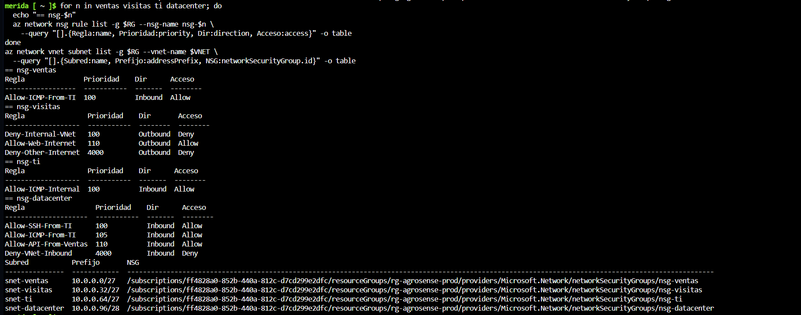{width=100%}

Para verificar la conectividad se desplegaron dos máquinas virtuales Ubuntu Server 22.04 LTS sin IP pública: vm-ti-01 en snet-ti (10.0.0.68) y vm-ventas-01 en snet-ventas (10.0.0.4). Ambas direcciones corresponden a la primera IP utilizable de su subred, ya que Azure reserva las direcciones .0 a .3 de cada bloque.

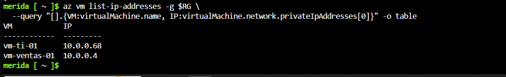{width=80%}

**Pruebas de conectividad.** La prueba consistió en ejecutar `ping -c 4 10.0.0.4` en vm-ti-01 para verificar la comunicación con vm-ventas-01. Como las VMs no tienen IP pública, el comando se ejecutó mediante la función Run Command de Azure, que permite correr comandos dentro de una VM desde Azure CLI sin abrir puertos de administración. El tráfico ICMP fue permitido por la regla Allow-ICMP-From-TI de nsg-ventas.

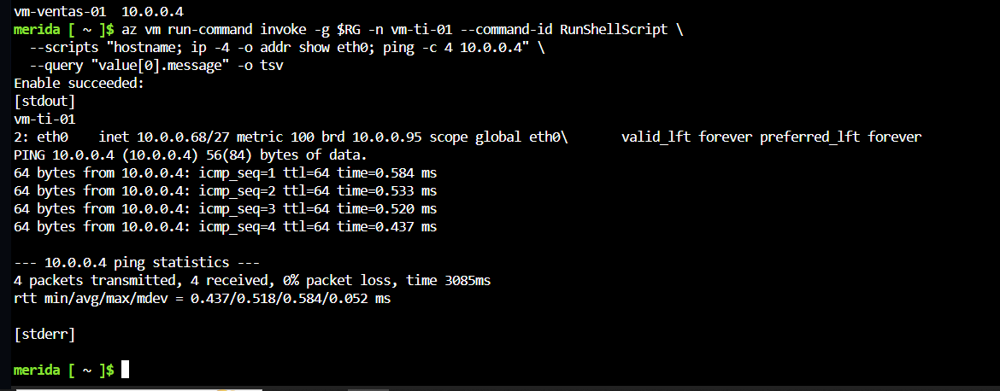{width=90%}

Se transmitieron 4 paquetes ICMP y se recibieron 4 respuestas, con 0 % de pérdida y un tiempo de respuesta promedio de 0.518 ms. La interfaz de vm-ti-01 muestra 10.0.0.68/27 con broadcast 10.0.0.95, que coincide con lo calculado para snet-ti en la sección 3. El TTL se mantuvo en 64 aunque el tráfico cruza entre dos subredes, lo que evidencia que Azure enruta entre subredes mediante su red definida por software, sin un salto de router tradicional que decremente el TTL.

**Apagado y limpieza de recursos.** Al finalizar las pruebas de la Fase 1 se eliminó el grupo de recursos rg-agrosense-prod con `az group delete`, lo que borró en una sola operación las VMs, sus discos, interfaces, NSG y la red virtual. Se optó por eliminar los recursos en lugar de solo desasignar las VMs, ya que una VM desasignada deja de cobrar cómputo pero sus discos siguen generando costo. Todo el despliegue puede reproducirse con el script agrosense-deploy.sh.

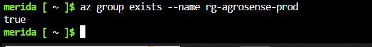{width=70%}

**Conclusiones de la prueba de concepto.** La prueba demostró que el diseño de red propuesto es implementable en Microsoft Azure: la VNet y sus cuatro subredes se crearon según el cálculo VLSM, los controles de seguridad se aplicaron mediante un NSG por subred y se verificó la conectividad entre TI y Ventas con 0 % de pérdida. Las restricciones de región y capacidad encontradas en Azure for Students mostraron la importancia de validar la disponibilidad de recursos antes de una implementación productiva.

# 7. Fase 2: alcance y cumplimiento de requisitos

La Fase 2 pone en operación los servicios del negocio sobre la infraestructura de la Fase 1, que se volvió a desplegar el 16 de noviembre de 2026. La tabla resume cada requisito del enunciado, cómo se cumplió y dónde está su evidencia.

| Requisito del enunciado | Implementación | Evidencia |
|------------------------------|---------------------------------------------|-------------------------|
| Servidor DNS interno | BIND 9.18 con las zonas agrosense.local e inversa 0.0.10.in-addr.arpa, en 10.0.0.105; es el DNS de la VNet | Sección 9.2, Figuras 12 a 14 |
| Intranet de RRHH solo desde la red interna, con nombre de dominio interno | nginx en vm-rrhh-web (10.0.0.106), sin IP pública, publicado como rrhh.agrosense.local | Sección 9.3, Figuras 12, 15 y 16 |
| Visitas con Internet, pero sin acceso a las subredes internas | nsg-visitas: Deny-Internal-VNet y salida solo web hacia Internet; DNS de Azure en Visitas | Figuras 14, 17 y 20 |
| TI con conectividad a todas las subredes; las demás sin conectividad hacia TI | nsg-ti: Deny-Inbound-VNet; reglas Allow-SSH/ICMP-From-TI en el Data Center y la DMZ | Figuras 16, 18, 19 y 20 |
| Intranet accesible desde las demás subredes (excepto Visitas) y no desde Internet | nsg-datacenter: Allow-Intranet-Web desde Ventas, TI y Data Center; sin IP pública | Figuras 15 a 19 y 22 |
| Hardening en todas las instancias | ufw con "denegar todo lo entrante" por rol, SSH endurecido, servicios y paquetes innecesarios eliminados, sysctl de red | Sección 11, Figuras 10 y 11 |
| DMZ con servidor web público de Ventas y dominio público | snet-dmz (10.0.0.112/28), vm-dmz-web con IP pública estática y dominio agrosense-ventas-gt.brazilsouth.cloudapp.azure.com | Sección 9.4, Figuras 21 y 22 |
| Punto extra: SSL/TLS y redirección HTTP → HTTPS | Certificado de Let's Encrypt y redirección 301 en nginx, con HSTS | Figuras 21 y 22 |

# 8. Diagrama de red actualizado

La Figura 7 muestra la red de la Fase 2 tal como quedó desplegada. A la VNet de la Fase 1 se suma la subred snet-dmz, que ocupa la antigua Reserva Futura A. El Data Center aloja la VM vm-rrhh-web con dos servicios, cada uno con su propia IP: la intranet de RRHH (10.0.0.106) y el DNS interno (10.0.0.105). La DMZ aloja vm-dmz-web, el único equipo con IP pública. La VM vm-cliente-01 es el equipo de pruebas que se mueve entre Ventas, TI y Visitas para comprobar las reglas.

El firewall se implementa en dos niveles: un NSG por subred, que filtra el tráfico en la red de Azure, y ufw dentro de cada VM. Las flechas azules son el tráfico interno permitido, las verdes el tráfico con Internet y las rojas con ✕ el tráfico que bloquea un NSG.

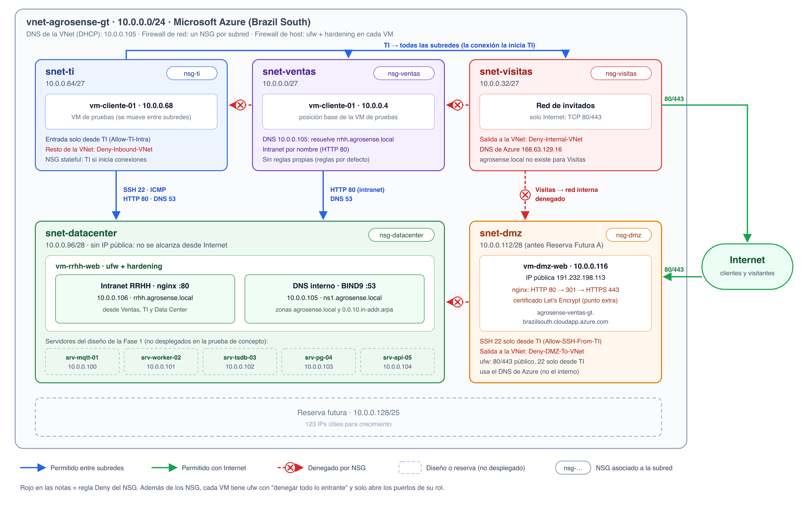{width=100%}

# 9. Implementación de los servicios

## 9.1 Infraestructura base y máquinas virtuales

La base de la Fase 1 se volvió a crear en Brazil South con el mismo grupo de recursos (rg-agrosense-prod), la misma VNet (10.0.0.0/24), las cuatro subredes originales y la nueva snet-dmz, cada una con su NSG. Sobre esa base se crearon tres VMs con Ubuntu Server 22.04 LTS:

| VM | Subred | IP privada | IP pública | Tamaño | Función |
|-------------|----------------|------------------|----------------|---------------|----------------------|
| vm-rrhh-web | snet-datacenter | 10.0.0.106 y 10.0.0.105 | No tiene | Standard_D2as_v4 | Intranet de RRHH (.106) y DNS interno (.105) |
| vm-dmz-web | snet-dmz | 10.0.0.116 | 191.232.198.113 (estática) | Standard_D2as_v4 | Web pública de Ventas |
| vm-cliente-01 | snet-ventas (se mueve a TI y Visitas) | 10.0.0.4 / 10.0.0.68 / 10.0.0.36 | No tiene | Standard_D2s_v4 | Equipo de pruebas de DNS y de bloqueos |

**Límite de cuota.** Azure for Students tiene dos límites en Brazil South: 6 vCPU en total por región y 4 vCPU por familia de tamaño. Las VMs desasignadas también cuentan; solo eliminarlas libera cuota. El tamaño más pequeño disponible fue de 2 vCPU, así que caben exactamente 3 VMs (6/6 vCPU): vm-rrhh-web y vm-dmz-web llenan la familia DASv4 (4/4) y vm-cliente-01 usa la familia DSv4 (2/4). Por eso el DNS no tiene una VM propia: corre en vm-rrhh-web con una IP de servicio separada (10.0.0.105). Si se agrega cuota, basta mover esa IP a una VM dedicada, sin cambiar la configuración de los clientes.

**VM de pruebas.** Para probar desde cada subred sin crear más VMs, el script mover-cliente.sh desasigna vm-cliente-01, cambia la subred y la IP de su tarjeta de red y la vuelve a encender. Todas las VMs se administran con Azure Run Command, sin SSH desde Internet.

## 9.2 Servidor DNS interno (BIND9)

El servidor es BIND 9.18 en vm-rrhh-web. Escucha solo en su IP de servicio, 10.0.0.105 (una IP secundaria de la tarjeta de red), y en localhost. Es autoritativo para la zona directa agrosense.local y la zona inversa 0.0.10.in-addr.arpa; lo que no pertenece a esas zonas lo reenvía al resolver de Azure (168.63.129.16).

| Nombre | Tipo | Valor | Uso |
|------------------------------|--------|-------------------------------------|-------------------------|
| ns1.agrosense.local (alias dns) | A | 10.0.0.105 | Servidor DNS |
| rrhh.agrosense.local (alias intranet) | A | 10.0.0.106 | Intranet de RRHH |
| web-dmz.agrosense.local | A | 10.0.0.116 | Web pública (IP privada) |
| www.agrosense.local | CNAME | agrosense-ventas-gt.brazilsouth.cloudapp.azure.com | Dominio público de Ventas |
| ventas01.agrosense.local | A | 10.0.0.4 | Equipo de pruebas en Ventas |
| ti01.agrosense.local | A | 10.0.0.68 | Equipo de pruebas en TI |

Cada registro A tiene su PTR en la zona inversa. Las decisiones de configuración más importantes son:

- **Control de acceso en BIND.** La ACL internas (Ventas, TI y Data Center) es la única que puede consultar y usar la recursión. La subred de Visitas está en blackhole, así que BIND ignora sus paquetes. allow-transfer { none; } impide descargar la zona completa (AXFR) y la versión de BIND está oculta.
- **DNS de la VNet.** La VNet tiene como DNS personalizado 10.0.0.105, y las VMs lo reciben por DHCP. El DNS configurado en la tarjeta de red tiene prioridad sobre el de la VNet, y eso se usa para dos excepciones: vm-dmz-web usa el DNS de Azure, porque la DMZ no puede salir hacia la red interna, y la VM en Visitas también, para que navegue por nombre sin conocer agrosense.local.
- **Detalle de Ubuntu con .local.** systemd-resolved trata los nombres terminados en .local como mDNS y no los manda al servidor DNS. Por eso en los clientes se declara agrosense.local como dominio de búsqueda en netplan. Así las consultas de ese dominio llegan a 10.0.0.105 y además funciona el nombre corto (rrhh).

## 9.3 Intranet de Recursos Humanos

La intranet es una página HTML estática servida por nginx en vm-rrhh-web (10.0.0.106), con server_name rrhh.agrosense.local y server_tokens off. La VM no tiene IP pública, así que desde Internet ni siquiera existe una dirección a la cual conectarse. Dentro de la red la protegen dos capas. La regla Allow-Intranet-Web de nsg-datacenter solo deja pasar el puerto 80 desde Ventas, TI y el Data Center, y la regla Deny-VNet-Inbound (prioridad 4000) bloquea todo lo demás. Además, ufw en la VM solo acepta el puerto 80 desde esas mismas subredes. Los usuarios llegan a ella por nombre gracias al registro rrhh.agrosense.local del DNS interno.

## 9.4 DMZ y servidor web público de Ventas

La DMZ es la subred snet-dmz (10.0.0.112/28). En ella está vm-dmz-web (10.0.0.116), con una IP pública estática (191.232.198.113) y la etiqueta DNS de Azure agrosense-ventas-gt, que da el dominio público **agrosense-ventas-gt.brazilsouth.cloudapp.azure.com**. nginx publica el sitio de Ventas.

La DMZ queda aislada con nsg-dmz. Solo acepta 80 y 443 desde Internet, y SSH únicamente desde TI. Su regla de salida Deny-DMZ-To-VNet le impide iniciar conexiones hacia cualquier subred interna, de modo que, si el servidor público fuera comprometido, no serviría como puente hacia la intranet, el DNS o TI.

**Punto extra: HTTPS.** El certificado se obtuvo de Let's Encrypt con certbot (plugin de nginx), que valida el dominio por HTTP en el puerto 80 y configura la redirección 301 de HTTP a HTTPS. El certificado vence el 15 de febrero de 2027 y el temporizador certbot.timer lo renueva automáticamente. Como parte del hardening se agregaron las cabeceras Strict-Transport-Security (HSTS), X-Content-Type-Options, X-Frame-Options y Referrer-Policy.

# 10. Firewall y listas de control de acceso en Azure

## 10.1 Capas de control

El tráfico se filtra en tres capas independientes, de modo que un error en una no deja el servicio expuesto:

1. **NSG por subred (firewall de red de Azure).** Deciden qué tráfico entra o sale de cada subred. Son la implementación principal de las ACL que pide el enunciado.
2. **ufw en cada VM (firewall de host).** Política "denegar todo lo entrante" y solo los puertos del rol de cada VM, abiertos únicamente a las subredes que los necesitan.
3. **ACL del propio servicio.** BIND solo responde a las subredes internas e ignora a Visitas (sección 9.2).

Un ejemplo de defensa en profundidad: un equipo de Ventas que intente SSH a vm-rrhh-web es bloqueado por el NSG (Deny-VNet-Inbound) y, aunque el NSG lo permitiera, ufw lo descartaría, porque el puerto 22 solo está abierto para TI.

## 10.2 Reglas de los NSG

La Figura 8 muestra la asociación de cada NSG a su subred y el DNS de la VNet. La Figura 9 muestra todas las reglas tal como están en Azure. La tabla explica el propósito de cada una.

| NSG | Prio | Dir. | Regla | Origen → destino, puerto | Propósito |
|------------|-------|-----------|-------------------|----------------------|-----------------------------|
| nsg-ventas | — | — | (sin reglas propias) | — | Ventas usa las reglas por defecto. El acceso hacia Ventas lo controlan los NSG de origen. |
| nsg-visitas | 110 | Salida | Deny-Internal-VNet | \* → 10.0.0.0/24, todos | Visitas no puede iniciar conexiones hacia ninguna subred interna. |
| nsg-visitas | 120 | Salida | Allow-Web-Internet | Visitas → Internet, TCP 80/443 | Los invitados navegan por la web. |
| nsg-visitas | 4000 | Salida | Deny-Other-Internet | Visitas → Internet, todos | El resto del tráfico hacia Internet se bloquea. |
| nsg-ti | 100 | Entrada | Allow-TI-Intra | TI → TI, todos | Los equipos de TI se comunican entre sí. |
| nsg-ti | 4000 | Entrada | Deny-Inbound-VNet | 10.0.0.0/24 → TI, todos | Ninguna otra subred puede iniciar conexiones hacia TI. |
| nsg-datacenter | 110 | Entrada | Deny-DNS-From-Visitas | Visitas → 10.0.0.105, 53 | Visitas no puede consultar el DNS interno. |
| nsg-datacenter | 115 | Entrada | Allow-DNS-Internal | Ventas, TI, DC → 10.0.0.105, 53 | Consultas DNS de las subredes internas (UDP y TCP). |
| nsg-datacenter | 120 | Entrada | Allow-Intranet-Web | Ventas, TI, DC → 10.0.0.106, TCP 80 | Acceso a la intranet desde todas las subredes excepto Visitas. |
| nsg-datacenter | 130 | Entrada | Allow-SSH-From-TI | TI → Data Center, TCP 22 | Administración remota solo desde TI. |
| nsg-datacenter | 135 | Entrada | Allow-ICMP-From-TI | TI → Data Center, ICMP | Diagnóstico (ping) desde TI. |
| nsg-datacenter | 4000 | Entrada | Deny-VNet-Inbound | 10.0.0.0/24 → Data Center, todos | Cierra todo lo que no se permitió arriba. |
| nsg-dmz | 100 | Entrada | Allow-Web-Internet | Internet → DMZ, TCP 80/443 | Publicación del sitio web. |
| nsg-dmz | 110 | Entrada | Allow-SSH-From-TI | TI → DMZ, TCP 22 | Administración solo desde TI. |
| nsg-dmz | 100 | Salida | Deny-DMZ-To-VNet | DMZ → 10.0.0.0/24, todos | La DMZ no puede iniciar conexiones hacia la red interna. |

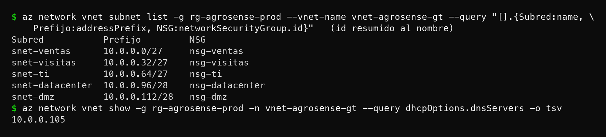{width=100%}

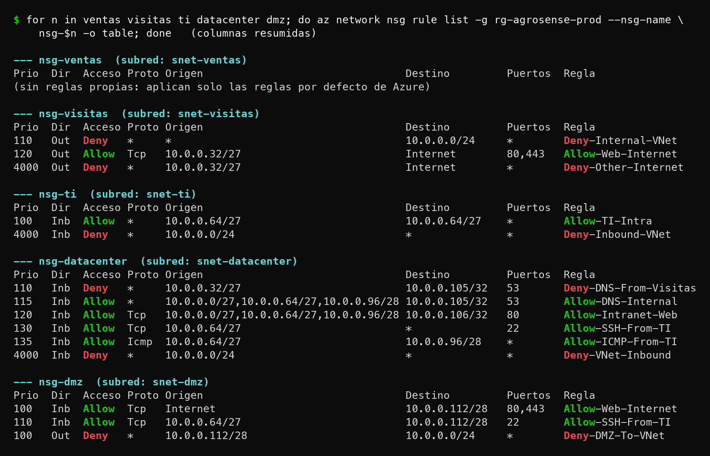{width=100%}

## 10.3 Consideraciones de configuración del firewall en Azure

- **Los NSG son stateful.** Si una conexión se permite, la respuesta vuelve sin necesitar otra regla. Por eso TI puede conectarse a cualquier subred aunque nadie pueda iniciar conexiones hacia TI.
- **Prioridad y primer acierto.** Azure evalúa las reglas de menor a mayor número (100 a 4096) y se detiene en la primera que coincide. Los Allow específicos van con números bajos y el Deny general al final (4000).
- **Las reglas por defecto permiten todo dentro de la VNet.** Cada NSG trae AllowVnetInBound y AllowVnetOutBound (prioridad 65000), así que cualquier aislamiento interno necesita un Deny explícito. Sin Deny-VNet-Inbound, por ejemplo, Ventas podría llegar al SSH del Data Center. Desde Internet ocurre lo contrario: DenyAllInBound bloquea todo lo que no se permita expresamente.
- **Origen y destino.** Entre dos subredes se evalúan el NSG de salida del origen y el NSG de entrada del destino, y ambos deben permitir el tráfico. Visitas y la DMZ se aíslan con reglas de salida (no pueden iniciar conexiones). TI y el Data Center se protegen con reglas de entrada (nadie no autorizado puede llegar).
- **Etiquetas de servicio.** Se usaron Internet y el rango de la VNet (10.0.0.0/24). La IP 168.63.129.16, del DNS y DHCP de Azure, es una dirección de plataforma: las reglas hacia Internet no la bloquean. Por eso Visitas y la DMZ resuelven nombres públicos aunque tengan su salida restringida.
- **Sin IP pública no hay exposición.** Solo vm-dmz-web tiene IP pública. La intranet y el DNS no tienen ninguna, así que no se pueden alcanzar desde Internet aunque una regla se configurara mal.
- **Administración sin abrir puertos.** Todas las VMs se administran con Azure Run Command, que pasa por el agente de Azure en la VM, sin exponer SSH a Internet.
- **Verificación con Network Watcher.** La herramienta IP flow verify indica, para un paquete concreto, si un NSG lo permite o lo deniega y qué regla decide. Se usó como evidencia complementaria (Figuras 19 y 20).
- **Cambios en caliente y reproducibles.** Los cambios en un NSG se aplican en segundos, sin reiniciar las VMs. Todas las reglas están en el script fase2/firewall/nsg-reglas.sh, que se puede volver a ejecutar sin efectos secundarios. Ese script no vuelve a crear un NSG que ya existe, porque recrearlo borraría sus reglas.

# 11. Hardening de las instancias

El hardening se aplicó a las tres VMs con dos scripts del repositorio. El script fase2/hardening/hardening.sh hace lo siguiente:

- deshabilita servicios innecesarios (avahi, cups, rpcbind, ModemManager, postfix) y elimina paquetes de protocolos en texto plano (telnet, rsh, vsftpd, tftp);
- endurece SSH: sin root, sin contraseña (solo llave), máximo 3 intentos, sin reenvío X11 ni de agente;
- activa ufw con "denegar todo lo entrante" y agrega las reglas del rol sin borrar las existentes.

El script fase2/hardening/hardening-extra.sh lo complementa:

- aplica parámetros de red del kernel: sin redirecciones ICMP, sin source routing, filtro de ruta inversa estricto, registro de paquetes "marcianos" y SYN cookies;
- deshabilita snapd, packagekit y multipathd, que vienen en la imagen de Azure y no se usan, y quita el cliente ftp;
- en SSH, desactiva los túneles TCP y desconecta las sesiones inactivas;
- agrega las cabeceras HTTP de seguridad en la web pública.

| VM | Puertos abiertos en ufw (origen permitido) | Todo lo demás |
|---------------|-----------------------------------------------------------------|--------------------|
| vm-rrhh-web | 22/TCP (TI); 80/TCP (Ventas, TI, Data Center); 53/UDP-TCP hacia 10.0.0.105 (Ventas, TI, Data Center) | Denegado |
| vm-dmz-web | 80 y 443/TCP (cualquiera, sitio público); 22/TCP (TI) | Denegado |
| vm-cliente-01 | 22/TCP (TI) | Denegado |

Las Figuras 10 y 11 muestran, para el Data Center y la DMZ, los puertos en escucha, las reglas de ufw, la configuración efectiva de SSH (sshd -T) y los parámetros sysctl. Los servicios que escuchan en localhost (systemd-resolved, chrony y el control rndc de BIND) no son accesibles desde la red.

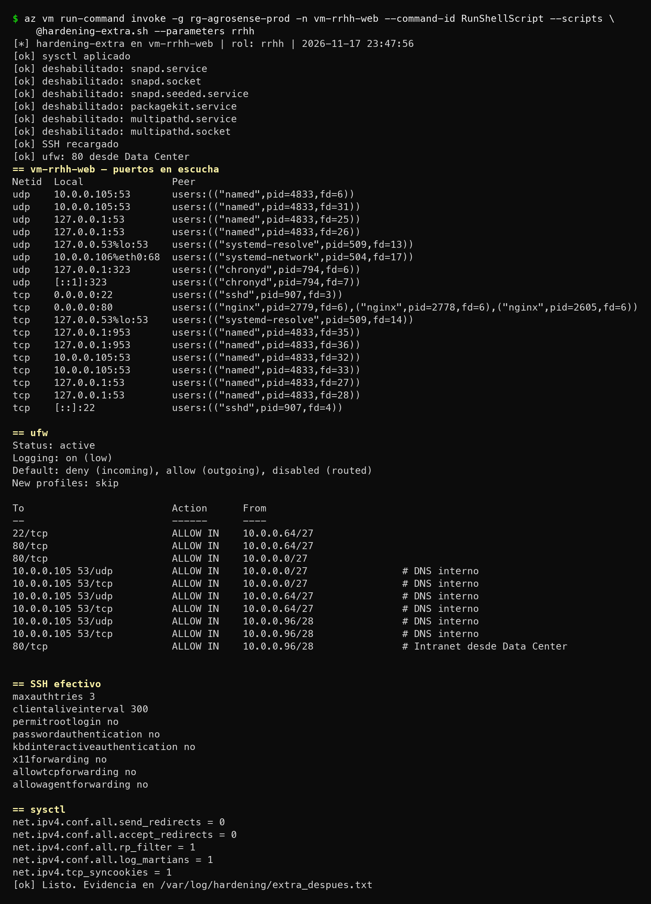{width=88%}

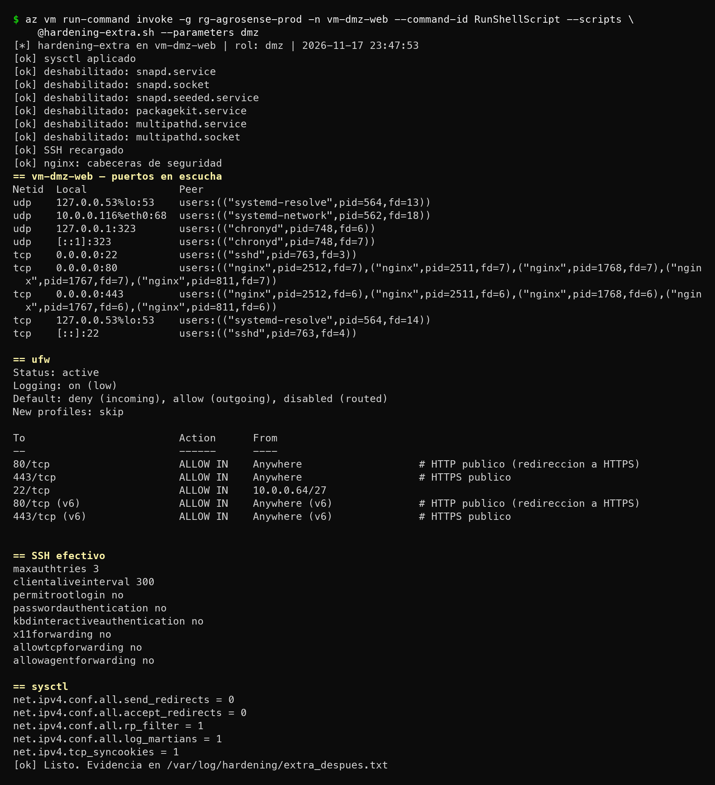{width=88%}

# 12. Pruebas y evidencias

Todas las pruebas se hicieron el 17 de noviembre de 2026, después de los últimos cambios a los NSG y del hardening, con los scripts de fase2/pruebas y fase2/dns, ejecutados mediante Azure Run Command. Las salidas completas están en fase2/evidencias y fase2/dns/evidencias del repositorio.

## 12.1 Resolución DNS interna

Desde Ventas y TI, vm-cliente-01 resuelve rrhh.agrosense.local a 10.0.0.106 consultando al DNS interno, y también por el nombre corto rrhh. Funcionan la resolución inversa y la de nombres de Internet (reenviada a Azure). La transferencia de zona es rechazada, y la intranet carga por nombre (Figuras 12 y 13). Desde Visitas, la consulta directa a 10.0.0.105 no obtiene respuesta y rrhh.agrosense.local no existe para su DNS, pero Internet funciona (Figura 14).

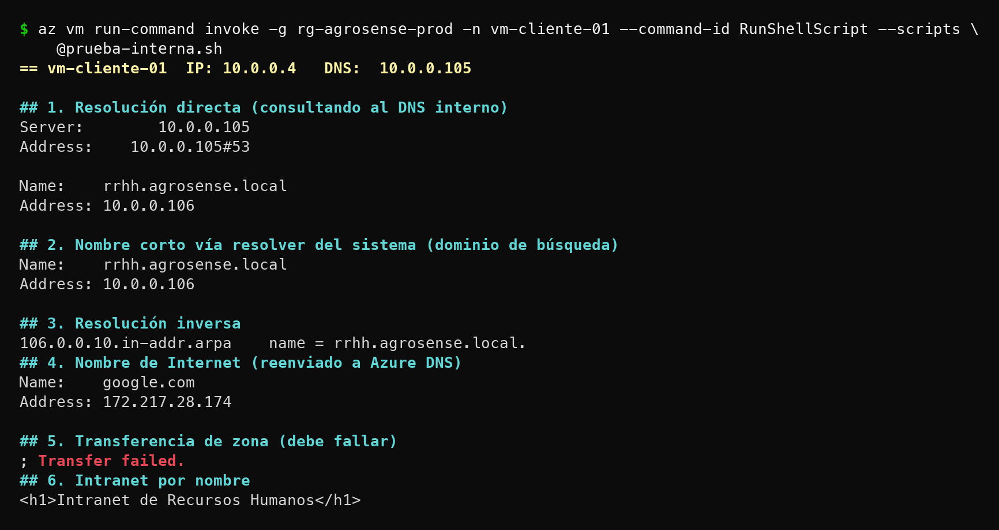{width=92%}

{width=92%}

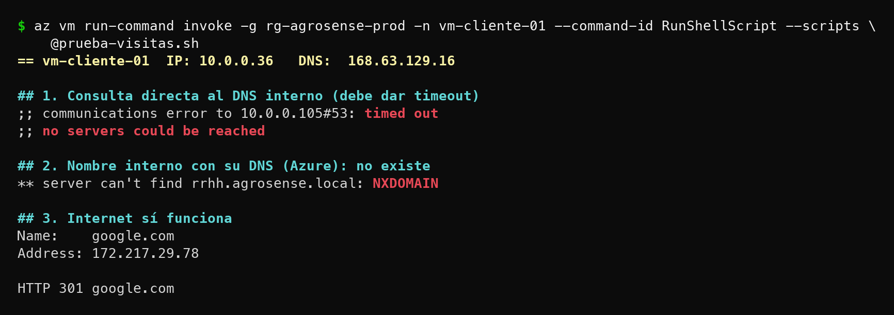{width=92%}

## 12.2 Bloqueos de tráfico entre subredes

La matriz se ejecutó desde vm-cliente-01 en cada subred (Figuras 15 a 17) y desde los servidores del Data Center y de la DMZ (Figura 18). "BLOQUEADO" significa que el paquete se descartó y no hubo respuesta. Los casos sin una VM de destino disponible se verificaron con IP flow verify de Network Watcher (Figuras 19 y 20).

| # | Origen | Destino y servicio | Esperado | Resultado (regla que decide) | Figura |
|-----|----------|-----------------------|------------|--------------------------------------|------------|
| 1 | Ventas | DNS 10.0.0.105:53 | Permitido | Permitido (Allow-DNS-Internal) | 15 |
| 2 | Ventas | Intranet HTTP 80 | Permitido | Permitido, HTTP 200 (Allow-Intranet-Web) | 15 |
| 3 | Ventas | Intranet SSH 22 e ICMP | Bloqueado | Bloqueado (Deny-VNet-Inbound) | 15, 19 |
| 4 | Ventas | TI | Bloqueado | Bloqueado (Deny-Inbound-VNet) | 20 |
| 5 | TI | Intranet SSH, ICMP, HTTP y DNS | Permitido | Permitido (Allow-SSH/ICMP-From-TI y reglas del Data Center) | 16, 19 |
| 6 | TI | DMZ SSH, HTTPS e ICMP | Permitido | Permitido (Allow-SSH-From-TI) | 16, 19 |
| 7 | TI | Ventas | Permitido | Permitido (AllowVnetInBound) | 19 |
| 8 | Visitas | DNS, intranet y DMZ privada | Bloqueado | Bloqueado (Deny-Internal-VNet) | 14, 17, 20 |
| 9 | Visitas | Ventas y TI | Bloqueado | Bloqueado (Deny-Internal-VNet) | 20 |
| 10 | Visitas | Internet HTTP/HTTPS y web pública | Permitido | Permitido, HTTP 200 y 301 (Allow-Web-Internet) | 17, 20 |
| 11 | Visitas | Internet, otros puertos | Bloqueado | Bloqueado (Deny-Other-Internet) | 20 |
| 12 | Data Center | Ventas | Permitido | Permitido (ping responde) | 18 |
| 13 | Data Center | TI | Bloqueado | Bloqueado (Deny-Inbound-VNet) | 18, 20 |
| 14 | DMZ | Intranet, DNS interno y TI | Bloqueado | Bloqueado (Deny-DMZ-To-VNet) | 18, 19 |
| 15 | DMZ | Internet | Permitido | Permitido, HTTP 200 | 18 |
| 16 | Internet | Web pública HTTP / HTTPS | Redirección y acceso | 301 → HTTPS, 200 OK (Allow-Web-Internet) | 21, 22 |
| 17 | Internet | SSH de la DMZ | Bloqueado | Bloqueado (DenyAllInBound) | 19, 22 |
| 18 | Internet | Intranet | Bloqueado | Sin IP pública (DenyAllInBound) | 19, 22 |

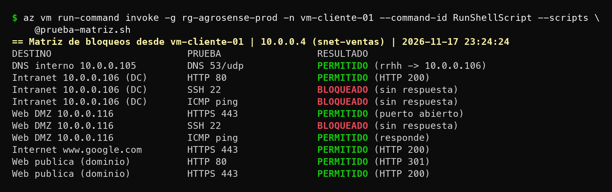{width=92%}

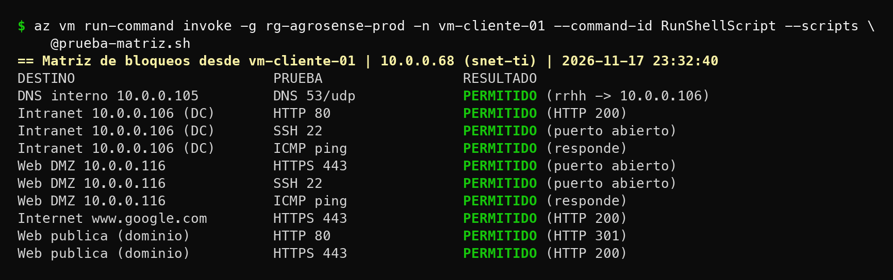{width=92%}

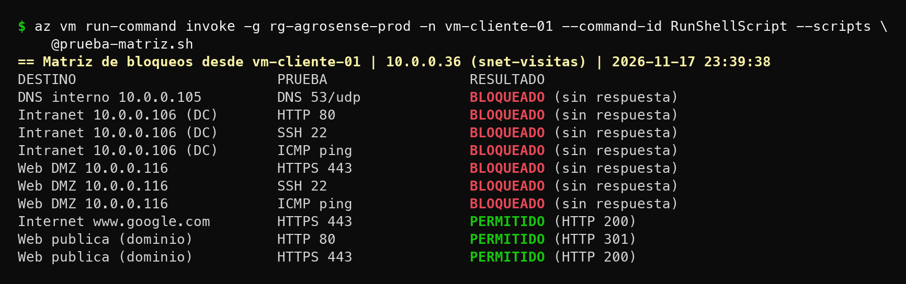{width=92%}

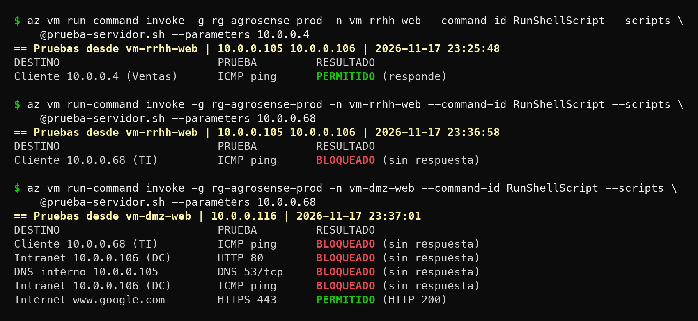{width=95%}

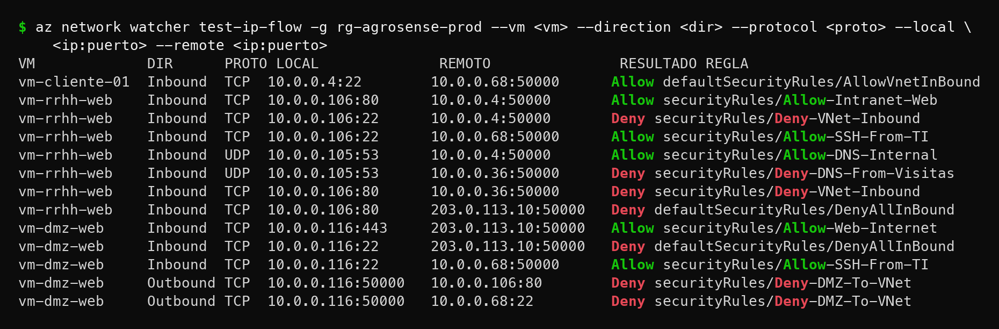{width=100%}

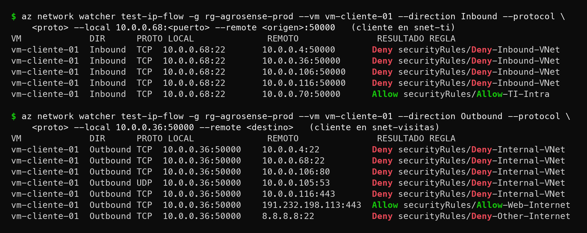{width=100%}

## 12.3 Acceso a la web pública

La Figura 21 es una captura del sitio de Ventas cargado por HTTPS desde Internet, en https://agrosense-ventas-gt.brazilsouth.cloudapp.azure.com. La Figura 22 muestra lo siguiente:

- la petición HTTP recibe 301 hacia HTTPS y la HTTPS responde 200 OK con las cabeceras de seguridad;
- el certificado es emitido por Let's Encrypt;
- el dominio resuelve a la IP pública;
- el SSH de la DMZ no responde desde Internet;
- rrhh.agrosense.local no existe en un DNS público;
- solo vm-dmz-web tiene IP pública.

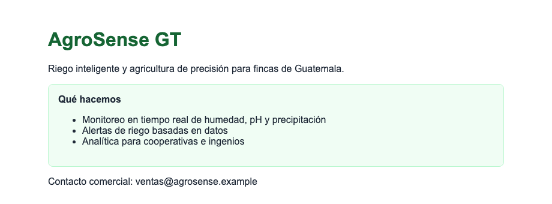{width=75%}

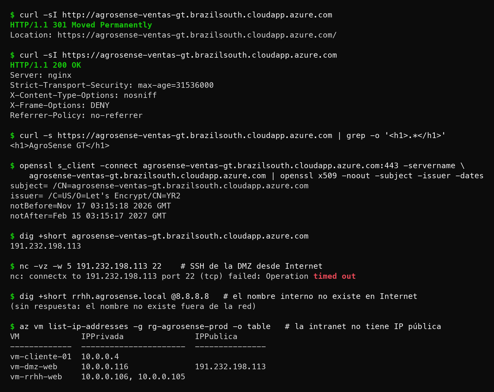{width=100%}

# 13. Integrantes, servicios implementados y tiempo estimado

| Integrante | Servicios y configuraciones que implementó | Tiempo estimado |
|--------------------|-----------------------------------------------------------------|---------------|
| Samuel Mejía 23442 | Re-despliegue de la base de la Fase 1 en Brazil South: grupo de recursos, VNet, cinco subredes (incluida snet-dmz) y cinco NSG con su asociación. Reglas de aislamiento de Visitas y de TI, y cierre de nsg-datacenter (Allow-SSH-From-TI y Deny-VNet-Inbound). Permisos del equipo en la suscripción. | 2 h |
| Jose Sanchez 231221 | Intranet de RRHH: vm-rrhh-web con nginx y página estática, sin IP pública. VM de la DMZ con IP pública estática y dominio público, sitio de Ventas en nginx, reglas de nsg-dmz y certificado de Let's Encrypt con redirección HTTP → HTTPS (punto extra). | 4 h |
| Pablo Cabrera 231156 | DNS interno con BIND9: zonas directa e inversa, ACL, reenviador e IP de servicio 10.0.0.105. Reglas NSG del puerto 53, DNS de la VNet y excepciones por NIC. VM de pruebas y pruebas de DNS. Integración final: ajuste de los NSG al enunciado, script único de NSG, complemento de hardening, matriz de pruebas, diagrama e informe. | 6 h (3 h de DNS y 3 h de integración) |
| Ángel Mérida 23661 | Script de hardening (hardening.sh) aplicado a las tres VMs: servicios y paquetes innecesarios, SSH sin root ni contraseña, ufw con "denegar todo" por rol. Revisión de los NSG y de las evidencias. | 3 h |
| Eliazar Canastuj 23384 | [COMPLETAR: servicios o configuraciones de Eliazar] | [COMPLETAR] |

# 14. Archivos de configuración utilizados

Todos los archivos están en el repositorio del proyecto, en la rama de la Fase 2. Los de configuración se incluyen completos en el Anexo A.

| Archivo | Ruta en el repositorio | Contenido |
|-------------------------|------------------------------|---------------------------------------------|
| named.conf.options | fase2/dns/named.conf.options | Opciones de BIND: ACL, recursión, reenviador y seguridad |
| named.conf.local | fase2/dns/named.conf.local | Declaración de las zonas directa e inversa |
| db.agrosense.local | fase2/dns/db.agrosense.local | Zona directa agrosense.local |
| db.10.0.0 | fase2/dns/db.10.0.0 | Zona inversa 0.0.10.in-addr.arpa |
| rrhh.conf | fase2/intranet/rrhh.conf | Sitio nginx de la intranet |
| ventas-https.conf | fase2/dmz/ventas-https.conf | Sitio nginx público con HTTPS y redirección (versión desplegada) |
| security-headers.conf | fase2/dmz/security-headers.conf | Cabeceras de seguridad HTTP |
| nsg-reglas.sh | fase2/firewall/nsg-reglas.sh | Todas las reglas NSG y su asociación a las subredes |
| hardening.sh y hardening-extra.sh | fase2/hardening/ | Hardening de las VMs (ufw, SSH, servicios y sysctl) |
| setup-dns.sh, vnet-dns.sh, cliente-dns.sh, add-ip-dns.sh | fase2/dns/ | Instalación de BIND, IP de servicio, DNS de la VNet y dominio de búsqueda |
| setup-intranet-standalone.sh, setup-dmz-standalone.sh, tls-letsencrypt.sh | fase2/intranet/ y fase2/dmz/ | Instalación de nginx, sitios y certificado |
| create-vm.sh, create-cliente.sh, mover-cliente.sh | fase2/intranet/, fase2/dmz/, fase2/dns/ | Creación de VMs y movimiento de la VM de pruebas |
| prueba-matriz.sh, prueba-servidor.sh, prueba-interna.sh, prueba-visitas.sh | fase2/pruebas/ y fase2/dns/ | Scripts de las pruebas de este informe |

# 15. Conclusiones

La Fase 2 dejó operativos los servicios que pedía el enunciado sobre la red diseñada en la Fase 1:

- un DNS interno que resuelve la intranet por nombre solo para las subredes autorizadas;
- una intranet de RRHH sin exposición a Internet;
- un sitio web público en una DMZ aislada, con HTTPS y redirección automática.

Las pruebas confirmaron cada regla del enunciado: Visitas solo tiene Internet, TI llega a todas las subredes mientras nadie llega a TI, la intranet se alcanza desde las subredes internas excepto Visitas, y la DMZ no puede iniciar conexiones hacia la red interna.

La lección principal fue que en Azure las subredes de una misma VNet se comunican libremente por defecto. La segmentación solo existe si cada aislamiento tiene un Deny explícito, y conviene repetir el control en el host (ufw) y en el servicio (ACL de BIND), para que un error en una capa no deje el servicio expuesto. Las restricciones de cuota de Azure for Students obligaron a compartir una VM entre el DNS y la intranet; separar el DNS en su propia IP de servicio permite moverlo a una VM dedicada en el futuro sin cambiar la configuración de los clientes.

# Anexo A. Archivos de configuración

## A.1 BIND9: named.conf.options

<<ARCHIVO:fase2/dns/named.conf.options>>

## A.2 BIND9: named.conf.local

<<ARCHIVO:fase2/dns/named.conf.local>>

## A.3 Zona directa: db.agrosense.local

<<ARCHIVO:fase2/dns/db.agrosense.local>>

## A.4 Zona inversa: db.10.0.0

<<ARCHIVO:fase2/dns/db.10.0.0>>

## A.5 netplan: IP de servicio del DNS y dominio de búsqueda

IP secundaria de vm-rrhh-web (/etc/netplan/60-dns-ip.yaml):

```yaml
network:
  version: 2
  ethernets:
    eth0:
      addresses: [10.0.0.105/28]
```

Dominio de búsqueda en los clientes (/etc/netplan/61-agrosense-dns.yaml):

```yaml
network:
  version: 2
  ethernets:
    eth0:
      nameservers:
        search: [agrosense.local]
```

## A.6 nginx: intranet de RRHH

<<ARCHIVO:fase2/intranet/rrhh.conf>>

## A.7 nginx: sitio público de Ventas con HTTPS

<<ARCHIVO:fase2/dmz/ventas-https.conf>>

<<ARCHIVO:fase2/dmz/security-headers.conf>>

## A.8 SSH y kernel (hardening)

/etc/ssh/sshd_config.d/00-hardening.conf (hardening.sh):

```
PermitRootLogin no
PubkeyAuthentication yes
PasswordAuthentication no
KbdInteractiveAuthentication no
PermitEmptyPasswords no
MaxAuthTries 3
LoginGraceTime 30
X11Forwarding no
AllowAgentForwarding no
```

/etc/ssh/sshd_config.d/01-hardening-extra.conf y /etc/sysctl.d/60-agrosense-hardening.conf (hardening-extra.sh):

```
AllowTcpForwarding no
ClientAliveInterval 300
ClientAliveCountMax 2
```

```
net.ipv4.ip_forward = 0
net.ipv4.conf.all.accept_redirects = 0
net.ipv4.conf.default.accept_redirects = 0
net.ipv4.conf.all.secure_redirects = 0
net.ipv4.conf.all.send_redirects = 0
net.ipv4.conf.default.send_redirects = 0
net.ipv4.conf.all.accept_source_route = 0
net.ipv4.conf.default.accept_source_route = 0
net.ipv4.conf.all.rp_filter = 1
net.ipv4.conf.default.rp_filter = 1
net.ipv4.conf.all.log_martians = 1
net.ipv4.icmp_echo_ignore_broadcasts = 1
net.ipv4.icmp_ignore_bogus_error_responses = 1
net.ipv4.tcp_syncookies = 1
net.ipv6.conf.all.accept_redirects = 0
net.ipv6.conf.default.accept_redirects = 0
```

## A.9 Firewall de Azure: nsg-reglas.sh

<<ARCHIVO:fase2/firewall/nsg-reglas.sh>>
